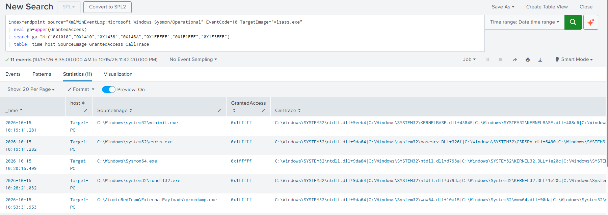

# D01: Detecting LSASS credential dumping (T1003.001)

**Author:** Mohamed Amine BAHRI · **Status:** lab-validated in Splunk on the development dataset; independent benign validation and Wazuh port pending · **Updated:** 2026-11-08

LSASS holds credential material for users logged on to a Windows machine, so reading its memory is a standard step once an attacker has admin rights. I tested four ways of dumping it against four detection signals. No single signal caught all four. Two complementary rules together caught every method tested, one on the behaviour (a process opening lsass to read its memory) and one on the artifact (a dump file written to disk).

## Setup

| | |
|---|---|
| Endpoint | Target-PC, Windows 10 22H2 (19045), domain `amine.local` (DC: ADDC01) |
| User | `AMINE\Administrator`, elevated (SeDebugPrivilege) |
| Telemetry | Sysmon 15.22, olafhartong balanced config (release 15.21, schema 4.91), sha256 `64BEC37BA849C5F2934A55D2A29E7DDFAE46A30D56F7F2908D1F8A454898797E`, frozen for all runs |
| SIEM | Splunk, index `endpoint` |

I dumped lsass four ways:

- **A1** comsvcs.dll MiniDump through `rundll32` (a trusted Windows binary, writes a file)
- **A2** Sysinternals ProcDump `-ma` (a signed admin tool, writes a file)
- **A3** Task Manager, "Create dump file" (a GUI click, writes a file)
- **A4** Mimikatz `sekurlsa::logonpasswords` (reads memory in place, writes nothing)

and looked at each through four Sysmon signals: **S1** command line (EID 1), **S2** DLL load (EID 7), **S3** dump file created (EID 11), **S4** process access to lsass (EID 10).

## 1. No signal catches everything

| Method | S1 command line | S2 DLL load | S3 dump file | S4 process access |
|---|---|---|---|---|
| A1 comsvcs | HIT | HIT | HIT | HIT |
| A2 ProcDump | HIT | HIT | HIT | HIT |
| A3 Task Manager | N/A | HIT | HIT | not collected |
| A4 Mimikatz | HIT (tool-specific strings) | MISS | N/A | HIT |

**S1** is per tool. The keywords that catch A1 and A2 don't match Mimikatz; A4 only appeared once I added Mimikatz-specific strings (`sekurlsa`), which only works if you already know the tool. A3 is a GUI click: no command is run for the dump, so there is nothing for S1 to match.

**S2** depends on the tool loading Windows' dump engine (`dbghelp`, `dbgcore`). In the Mimikatz run, no dump-engine DLL loaded: it reads the memory directly.

**S3** caught the dump file from A1, A2 and A3. Mimikatz writes nothing.

**S4** catches the access itself: A1, A2, A4. It misses A3 only because the Sysmon config excludes Task Manager as a source, so no event is ever produced.

A3 and A4 each sit in the other's blind spot. The detection is the union of S4 and S3.

## 2. Why the behaviour rule generalises

Every method with a collected access event (A1, A2, A4) opened lsass asking for the right to read its memory (`PROCESS_VM_READ`, bit `0x10` of the access mask). The full masks differed: `0x1FFFFF` (full access) for comsvcs and ProcDump, a lean `0x1010` for Mimikatz. The read bit was always set. Task Manager's mask was not measured, since its access event is not collected. That is what lets one rule catch tools it has never seen.

The rule should test that bit directly. Sigma cannot express a bitwise AND, so `rule.yml` approximates it with a list of masks that all have the bit set: `0x1010`, `0x1410`, `0x1438`, `0x143A`, `0x1FFFFF`, `0x1F1FFF`, `0x1F3FFF`. A read-capable mask outside the list would be missed.

Paths that avoid opening a fresh read handle, such as reusing an existing handle or dumping a clone of the process, may avoid this signal. I did not test them.

## 3. Same mask, opposite intent

Untuned over the attack day (2026-10-15), S4 returned 11 events: the 5 attack accesses plus 6 at boot, where `wininit`, `csrss` and Sysmon open lsass with `0x1FFFFF`, the same mask as ProcDump and comsvcs. The mask alone cannot separate them, so the rule suppresses those three by full path. Tuned, it returned only the 5 attack events (ProcDump opens lsass three times).

## 4. The artifact rule

S3 exists because S4 cannot see Task Manager. It matches a `.dmp` file written by a known dump tool (`taskmgr`, `procdump`, `rundll32`) or named like an lsass dump. A hit is a lead, not proof: these tools also write benign dumps of other processes. It misses a renamed custom tool writing a file not named after lsass, or output that is not a `.dmp`.

Both rules are rated medium. As analyst guidance, not automated here, a hit becomes high when corroborated: a dump file next to an access event, a call stack through `dbghelp`/`dbgcore`/`comsvcs`, or an unusual source process.

## Defender

The attacks ran with Defender off, restored afterwards. In a separate prevention test with Defender on, it blocked comsvcs and ProcDump. When it did, the SIEM showed no matching Sysmon events; the only trace was in Defender's own log. An empty SIEM is not evidence that nothing happened, so prevention telemetry has to be collected separately. Detection was measured with prevention off because a SOC cannot assume it is present: prevention settings differ between environments, and attackers disable AV or add exclusions.

## Limits and next steps

- The Sigma mask list approximates the read-bit test.
- Code injected into a suppressed source (`wininit`, `csrss`, Sysmon) is not caught.
- The 0 benign hits come from the same dataset the tuning was built on; validation on a fresh boot and normal-use window is still to run.
- One workstation, one domain, one Sysmon config, a known set of tools.
- Next: an evasion study with reflective Mimikatz, a read-capable mask outside the list, and injection into a trusted source.

## Files

- `rule.yml`: S4, process access (Sigma). `rule-dumpfile.yml`: S3, dump file (Sigma). `rule.spl`: both in SPL, plus the untuned S4 search.
- `evidence/`: one capture per cell of the matrix, named `A<n>-S<n>-*.png` (for example `A2-S3-dumpfile.png`, `A3-S4-empty.png`), `rule-untuned-11hits.png` and `rule-tuned-5hits.png` (S4 before and after tuning), and `sensor-probe.png`, the check that the sensor logs lsass access.

Mimikatz succeeded against a disposable lab account. No credential output, hashes, transcripts, binaries or dump files are in this repository; `.gitignore` blocks them.

Sysmon config based on olafhartong's [sysmon-modular](https://github.com/olafhartong/sysmon-modular). Technique: [MITRE ATT&CK T1003.001](https://attack.mitre.org/techniques/T1003/001/).
