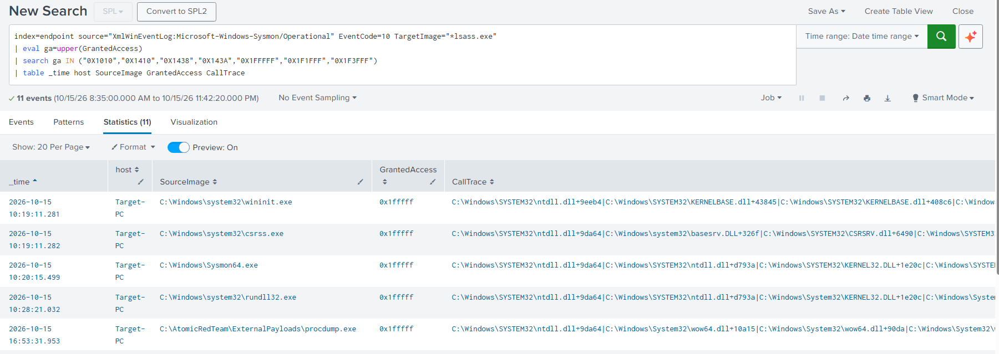
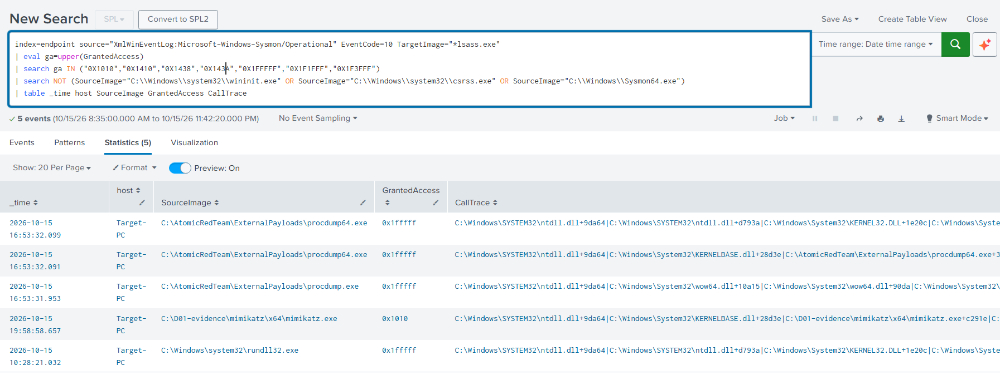
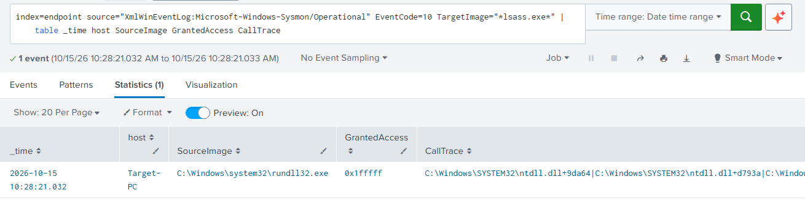
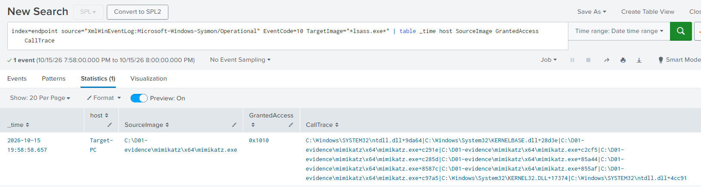

# D01 — Suspicious LSASS Access (MITRE ATT&CK T1003.001)

**Analytic:** OS Credential Dumping: LSASS Memory (T1003.001), Credential Access
**Author:** Mohamed Amine BAHRI
**Status:** complete · **Updated:** 2026-10-18
**Part of:** Detection Engineering and Attack Chain Evaluation in an Active Directory SOC Environment (EURECOM, Fall 2026)

---

## TL;DR

I took one credential theft technique, reading the memory of `lsass.exe`, and tested four different execution methods against four independent detection strategies. I classified every one of the sixteen cells with an evidence-based reason, measured the benign false-positive surface, and built a Sigma rule tuned against that baseline. The headline result: no single detection strategy covers all four attacks, and robust coverage comes from the union of a behavioral rule (process access) and an artifact rule (dump file). Every attack that ran had to open lsass and request permission to read its memory. The rule detects exactly that one action, which is why it catches all of them regardless of the tool used.

---

## Environment

| Item | Value |
|---|---|
| Monitored endpoint | Target-PC, Windows 10 22H2 (build 19045) |
| User context | `AMINE\Administrator`, elevated (admin token holds SeDebugPrivilege, which is what permits opening lsass memory) |
| Domain | `amine.local` (NetBIOS AMINE), DC: ADDC01 |
| Sysmon | 15.22 binary, olafhartong balanced config (release 15.21, schemaversion 4.91) |
| Config SHA-256 | `64BEC37BA849C5F2934A55D2A29E7DDFAE46A30D56F7F2908D1F8A454898797E` (frozen for all variants) |
| SIEM | Splunk, index `endpoint`, source `XmlWinEventLog:Microsoft-Windows-Sysmon/Operational` |
| Defender | ON for the prevention test, OFF for controlled execution, restored ON afterward |

The single config hash governed all four attack runs, which is what makes the study reproducible.

---

## 1. Hypothesis

A process that opens a handle to `lsass.exe` with a memory-read-capable access right is a candidate for credential dumping. This detects that a process gained the ability to read lsass memory. It does not prove credentials were stolen, which is why the rule is rated medium severity, not high.

## 2. Data contract

Primary sensor: Sysmon Event ID 10 (ProcessAccess) targeting `lsass.exe`, giving `SourceImage`, `GrantedAccess`, `CallTrace`, and `Source/TargetProcessGUID`. Supporting sensors for the comparison: EID 1 (ProcessCreate, command line), EID 7 (ImageLoad, DLL loads), EID 11 (FileCreate, dump files). The ProcessAccess include must cover lsass. A corrupted config silently dropped all EID 10 during an earlier phase, so the sensor was explicitly validated with a known-good trigger before any null result was trusted (see Limitations).

## 3. Attack variants

| ID | Method | Nature |
|---|---|---|
| A1 | `comsvcs.dll` MiniDump via `rundll32` | File-based LOLBin (living off the land) |
| A2 | Sysinternals ProcDump `-ma` | Signed third-party admin tool, file-based |
| A3 | Task Manager, Create dump file | GUI action, no attacker command line |
| A4 | Mimikatz `sekurlsa::logonpasswords` | In-memory read, no file written |

## 4. Coverage matrix

Detecting in Splunk, olaf config `64BEC37B`, Defender OFF.

| Variant | S1 command line (EID 1) | S2 image load (EID 7) | S3 dump file (EID 11) | S4 process access (EID 10) |
|---|---|---|---|---|
| **A1 comsvcs** | HIT | HIT | HIT | HIT |
| **A2 procdump** | HIT | HIT | HIT | HIT |
| **A3 taskmgr** | N/A | HIT | HIT | MISS |
| **A4 mimikatz** | HIT (tool strings only) | MISS | N/A | HIT |

Legend: HIT = detected; MISS = strategy should have caught it but did not; N/A = strategy does not apply to this mechanism.

## 5. Reading the matrix

**No single strategy covers all four variants.** Read the columns and the thesis falls out:

- **S1 (command line)** is per-tool and brittle. A generic keyword list (lsass, MiniDump, comsvcs, procdump, -ma) catches A1 and A2 but silently misses A4, which only matched on mimikatz-specific strings (`sekurlsa`). A3 has no attacker command line at all (a GUI click), so S1 is N/A, not a miss.
- **S2 (image load)** depends on the tool loading the Windows dump engine. A1 and A2 load `dbghelp.dll` / `dbgcore.dll` (`MiniDumpWriteDump`), so S2 catches them. Mimikatz (A4) reads lsass memory itself and never loads that engine, so S2 is structurally blind to it.
- **S3 (dump file)** catches anything that writes an lsass dump to disk: A1, A2, A3. It is N/A for A4, which extracts in memory and writes no file.
- **S4 (process access)** catches the behavior itself, opening lsass with a read-capable handle, and hit every variant that produced an event: A1, A2, A4. Its one miss, A3, is not a detection failure but a collection choice: the olaf config excludes `taskmgr.exe` as a ProcessAccess source at the sensor, so no EID 10 is ever generated and no SIEM query can recover it. A3 is covered by S3 instead.

**Conclusion: robust coverage is the union S4 (behavioral) plus S3 (artifact).** A4 lives where S3 is N/A and S4 saves it; A3 lives where S4 is blind and S3 saves it. The deliverable is therefore two complementary rules, not one.

**The S4 invariant (the reason to build on it):** three different tools produced three different masks and two different call-stack shapes, but every one set the `PROCESS_VM_READ` bit (`0x0010`):

| Variant | SourceImage | GrantedAccess | VM_READ bit | CallTrace fingerprint |
|---|---|---|---|---|
| A1 | rundll32.exe | 0x1FFFFF | yes | dbgcore then comsvcs |
| A2 | procdump64.exe | 0x1FFFFF | yes | dbgcore |
| A4 | mimikatz.exe | 0x1010 | yes | mimikatz frames only |

Mimikatz asks for the surgical minimum (`0x1010` = query + VM_READ), while the file-based dumpers take full access (`0x1FFFFF`). A rule keyed on "full access only" would miss mimikatz; a rule keyed on the dbgcore call trace would miss mimikatz; only the VM_READ bit unifies all three.

## 6. Benign baseline

The baseline measures what legitimately opens lsass, so that suppressions are justified by data rather than assumption. It was run under the frozen config with Defender ON, and the sensor was validated live during the same window (a deliberate `OpenProcess` probe from PowerShell was confirmed in Splunk).

An important methodology point: a 3-hour idle window showed zero benign access, but that was a window artifact. lsass is opened benignly mainly at boot and logon, not continuously, so an idle window undercounts. Expanding to a full day that included boots revealed the real population:

| SourceImage | Mask | When | Call trace |
|---|---|---|---|
| `C:\Windows\system32\wininit.exe` | 0x1FFFFF | boot | clean (system DLLs only) |
| `C:\Windows\system32\csrss.exe` | 0x1FFFFF | boot | clean |
| `C:\Windows\Sysmon64.exe` | 0x1FFFFF | boot | clean |

These three SYSTEM processes open lsass with the same full-access mask as A1 and A2, so **mask alone cannot separate benign from malicious**. The separators are the SourceImage (trusted system path) and the call trace (clean system DLLs versus a dbgcore/dbgcore/comsvcs dump engine). Each is suppressed by full path, with the residual risk recorded below. The AV engine (`MsMpEng.exe`) did not appear even over the full day, either excluded by the config or it did not scan lsass in-window.

Lesson for any future baseline: span the behavior's natural cadence, and include a boot or logon cycle.

## 7. The detection rule

`rule.yml` (Sigma) and `rule.spl` (hand-written Splunk). The rule fires on a handle to lsass carrying a VM_READ-capable mask, and suppresses the three measured benign SYSTEM sources by full path.

```
TargetImage endswith \lsass.exe
GrantedAccess in (0x1010, 0x1410, 0x1438, 0x143A, 0x1FFFFF, 0x1F1FFF, 0x1F3FFF)
and NOT SourceImage in (wininit.exe, csrss.exe, Sysmon64.exe  [full system paths])
```

The mask list is an enumerated approximation of the conceptual bitwise test `(GrantedAccess & 0x0010) != 0`, because Sigma and SPL cannot express a bitwise AND cleanly. This is documented as a limitation, not a flaw.

Two tiers, as independent detection paths rather than one AND-only rule:

| Tier | Meaning |
|---|---|
| medium (this rule) | a process obtained lsass memory-read capability, triage it |
| high (corroboration) | the access is backed by a suspicious command line (EID 1), a dump-engine load (EID 7), a dump file (EID 11), a dbgcore/dbghelp/comsvcs call trace, or an uncommon source image, lineage, signer, or user (for example Administrator opening a SYSTEM process) |

The rule is `medium` on purpose: a memory-read handle is capability, not proof of theft. Corroboration promotes it to high.

## 8. Results and measurements

Run over the full attack day (2026-10-15):

- **Untuned rule: 11 hits.** Six were benign boot-time access (wininit x2, csrss x2, Sysmon64 x2). Five were the attacks (A1 x1, A2 x3, A4 x1; ProcDump opens lsass more than once, and its 32-bit launcher plus 64-bit worker both appear).
- **Tuned rule: 5 hits, all attacks, zero false positives**, with no detection lost:

| _time | SourceImage | GrantedAccess |
|---|---|---|
| 10:28:21 | rundll32.exe (A1 comsvcs) | 0x1FFFFF |
| 16:53:31 | procdump.exe (A2 launcher) | 0x1FFFFF |
| 16:53:32 | procdump64.exe (A2) | 0x1FFFFF |
| 16:53:32 | procdump64.exe (A2) | 0x1FFFFF |
| 19:58:58 | mimikatz.exe (A4) | 0x1010 |

That is the measured before-and-after: six false positives removed, zero detections lost. A note on latency: these numbers reflect manual search over stored events, not automated alert latency, which is a separate concern.

## 9. Why this matters when Defender already prevents these tools

All attacks ran with Defender OFF to isolate the detection layer from the prevention layer. This is a standard methodology, and the honest framing is:

On a fully configured endpoint, default Defender does block comsvcs and ProcDump against lsass, and that was confirmed in the prevention test. But prevention is not detection, and a SOC assumes prevention can fail. The LSASS ASR rule is frequently unconfigured in real estates, attackers disable or add exclusions to AV (both done here, as an attacker would), and signatures are tool-specific while behavior is not: an obfuscated or novel tool evades the signature but still opens lsass with VM_READ. A further point proven by the data: when Defender prevents the attack at launch, it leaves zero Sysmon telemetry, so a SOC relying on prevention alone is blind in the SIEM. Detection is the layer that catches what prevention misses, and the behavioral rule here is tool-agnostic by design.

## 10. Limitations

- **Mask approximation.** The enumerated mask list approximates the bitwise VM_READ test. A mask with the `0x0010` bit set but not in the list would be missed. The list is extensible.
- **Suppression by SourceImage.** Excluding wininit, csrss, and Sysmon64 by path means an attacker who injects into one of them, or masquerades as them in a non-system path, could slip the medium tier. This is mitigated by the full-path match (blocks the rename case) and by the high tier, which keys on the call trace: a real boot-time wininit has a clean system-DLL stack, while injected code dumping lsass carries a dbgcore/dbghelp/UNKNOWN stack. The gap is real and is the subject of the planned evasion study.
- **Low FP is partly earned upstream.** The near-empty benign surface reflects the olaf config's own tuning (it logs only suspicious masks and excludes noisy sources), not only a quiet environment. A raw log-everything ProcessAccess config produced 91 events in seconds in a control test. State the result as "near-zero under this tuned collection," not "lsass is never accessed benignly."
- **Collection gap for A3.** Task Manager is excluded from ProcessAccess at the sensor, so S4 cannot see it. It is covered by S3 (the dump file it writes). An exclusion is only safe when paired with a compensating control.
- **Lab versus production.** Single workstation, one domain, a small set of known tools. The baseline must be re-measured, including a boot cycle, in any real environment before deployment.

## 11. Triage guidance

When the rule fires: check the SourceImage path and signature, then the parent process (EID 1), then whether a dump file was written (EID 11), then the user and the host (a domain controller is more severe than a workstation). An Administrator-to-SYSTEM crossing and a dbgcore/dbghelp call trace both raise confidence toward the high tier.

## 12. Next steps (A5, evasion and resilience)

Test the rule against the cases it is weakest on: reflective or in-memory Mimikatz (which produces UNKNOWN call-trace frames rather than on-disk ones), an open with a clean mask the rule does not list, and injection into a trusted source image. A rule surviving an evasion attempt is a valid result; a residual blind spot is documented, not hidden.

---

## Evidence

All screenshots are in [`evidence/`](./evidence). They are detection-side Splunk captures only (the query, plus SourceImage, GrantedAccess, CallTrace, command line, or file name). No Mimikatz output, hashes, or transcripts are included, by design.

**The rule, before and after tuning:**


*Untuned rule over 2026-10-15: 11 hits. Six are benign boot-time access (wininit, csrss, Sysmon64), five are the attacks.*


*Tuned rule: 5 hits, all attacks, 0 false positives.*

**Why the mask alone is not enough (same 0x1FFFFF, different intent):**


*A1 (comsvcs): 0x1FFFFF with a dbgcore then comsvcs call trace, the dump-engine fingerprint.*


*A4 (mimikatz): leaner 0x1010, call trace is all mimikatz frames with no dump engine. This is why the behavioral mask, not the call trace, is what unifies the variants.*

**Full per-variant evidence** backing every cell of the matrix is in `evidence/`, named `A<n>-S<n>-*.png` (for example `A2-S3-dumpfile.png`, `A3-S4-empty.png`), plus `sensor-probe.png` for the baseline sensor check.

## Credential hygiene

Mimikatz succeeded for a disposable lab account. Per lab policy, the recovered credential material was not screenshotted, saved, or committed. This repository contains only sanitized proof statements, the detection logic, and sanitized screenshots. The Mimikatz binary, any `.dmp` files, and the credential-bearing PowerShell transcript are excluded (`.gitignore` blocks `*.dmp`).
